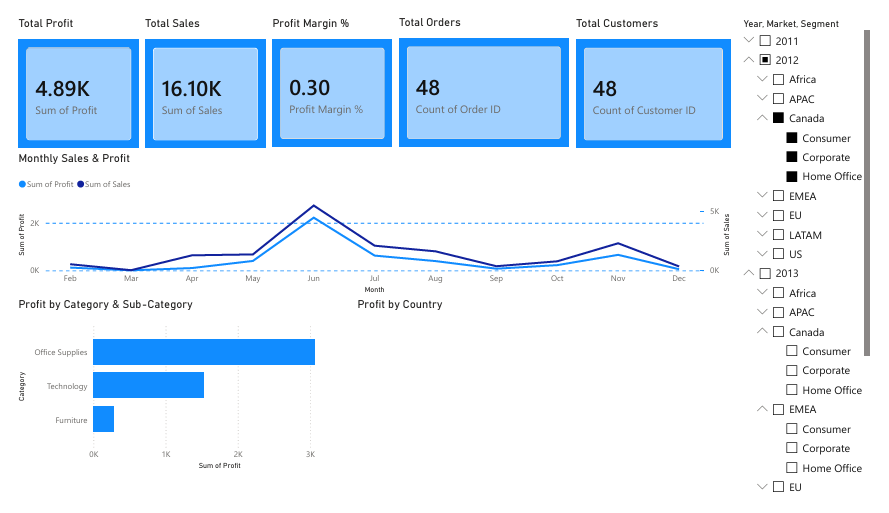
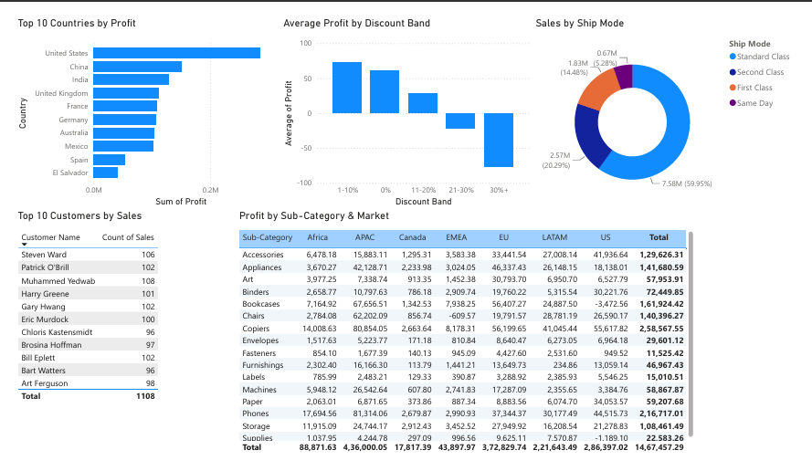

# Superstore Sales Analysis (Python + Power BI)

An analysis of the Global Superstore dataset: 51,290 order lines from 2011 to 2014. I cleaned the data and explored it in Python, then built a two-page Power BI dashboard on top of it.

The main finding: discounts above 20% lost money, and those order lines lost about 815K in profit combined.

## Dashboard

## Dataset

- Source: Global Superstore dataset on Kaggle (Global_Superstore2.csv)
- 51,290 rows, 24 columns
- Covers orders from 2011 to 2014 across 147 countries
- The file is not UTF-8, so load it with encoding="latin1"

## What I did

1. Data cleaning (Python, pandas)
   - Removed duplicates and fixed column names
   - Converted Order Date and Ship Date from text to dates (dd-mm-yyyy)
   - Dropped Postal Code, which is only filled for US rows (9,994 of 51,290)
   - Added Year, Month, Ship Days, Profit Margin and a loss flag
2. EDA (pandas, matplotlib, seaborn)
   - Sales and profit by year, category, sub-category, market and country
   - Profit by discount band, and a correlation heatmap
   - Outlier check on Profit
3. Dashboard (Power BI)
   - Page 1 shows the KPIs (sales, profit, margin, orders, customers), monthly trend, profit by category, and a map of profit by country
   - Page 2 covers the discount analysis, top and bottom countries, sales by ship mode, a sub-category by market matrix, and the top 10 customers
   - Measures written in DAX, with a separate date table

## Key findings

- Total sales were 12.64M and total profit 1.47M, a margin of 11.6%. There were 25,035 orders from 1,590 customers.
- Sales almost doubled from 2.26M in 2011 to 4.30M in 2014, but the margin stayed around 11-12%.
- Discounts drive the losses. Average margin by discount band:
  - 0%: 25.3%
  - 1-10%: 17.2%
  - 11-20%: 9.9%
  - 21-30%: -5.5%
  - over 30%: -51.3%
- About 24% of order lines lost money.
- Furniture has 4.11M in sales but a 6.9% margin, compared with 14.0% for Technology and 13.7% for Office Supplies. Tables is the only sub-category that loses money (-64K).
- APAC has the most sales (3.59M) and profit (436K). EMEA has the lowest margin at 5.4%.
- 29 of 147 countries lost money. The worst were Turkey (-98K), Nigeria (-81K) and the Netherlands (-41K). The best were China (151K), India (129K) and the UK (112K).
- Sales peak in November and December and are lowest in February.

## Suggestions from the data

- Cap discounts at 20%
- Review Tables pricing
- Look into why Turkey, Nigeria and the Netherlands lose money

## Tools

Python (pandas, NumPy, matplotlib, seaborn), Jupyter Notebook, Power BI Desktop, DAX

## Project structure

data/          raw dataset (or a link to it)
notebooks/     cleaning and EDA notebook
dashboard/     SUPERSTORE_EXECUTIVE_DASHBOARD.pbix
screenshots/   dashboard images

## Author

Ajay
GitHub: Ajaykumar1526
LinkedIn: ajay1526
